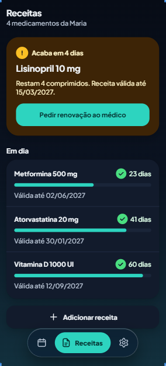
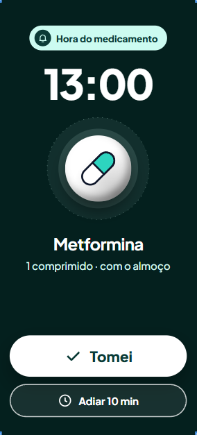

# Amparo

App de lembretes de medicação para cuidadores e para as pessoas de quem cuidam. Regista e lembra o que o médico decidiu; **nunca sugere, calcula nem interpreta nada clínico**.

> Projeto pessoal em desenvolvimento ativo. Backend completo e testado; app Flutter já ligada à API, com os fluxos principais.

## Ideia

- **Alarmes locais** que tocam à hora certa, mesmo com a app fechada, com "Adiar 10 minutos".
- **Vários perfis:** um cuidador acompanha várias pessoas. A pessoa acompanhada usa um modo simples e liga o telemóvel por código, sem criar conta.
- **Acompanhamento:** o cuidador vê as tomas, marca-as por quem precisa e recebe alertas.
- **Privacidade:** pensada para dados de saúde (RGPD), com consentimento explícito e registo de auditoria.
- **Sem anúncios nem venda de dados.** Segurança e acessibilidade ficam sempre gratuitas.

## Ecrãs

Mockups do desenho (feito no Claude Design, ver [`docs/design.md`](docs/design.md)).

| Hoje (cuidador) | Hoje (pessoa acompanhada) | Receitas | Alarme |
|---|---|---|---|
|  |  |  |  |

## Tecnologia

| Camada | Stack |
|---|---|
| App | Flutter (Android, iOS e web para desenvolvimento) |
| API | Node.js, Express 5, TypeScript, Zod |
| Base de dados | PostgreSQL, migrações com `node-pg-migrate` |
| Segurança | Argon2, JWT (`jose`), `helmet`, rate limiting, email cifrado com AES-256-GCM |
| Testes e CI | Vitest + Supertest, GitHub Actions |
| Infraestrutura | Podman, Caddy, backups cifrados com teste de restauro |
| Push | Firebase Cloud Messaging (só para notificações) |

## Estrutura

| Pasta | Conteúdo |
|---|---|
| `app/` | A app (Flutter) |
| `backend/` | A API (Node.js + Express + TypeScript + PostgreSQL) |
| `deploy/` | Configuração de deploy (Podman + Caddy) e backups |
| `docs/` | Plano técnico, desenho dos ecrãs, RGPD e planos das funcionalidades (ver [`docs/index.md`](docs/index.md)) |

## O que já está feito

### Backend
- **Autenticação:** email e palavra-passe, entrar com Apple e Google (validação de ID tokens no servidor), verificação do email e recuperação de palavra-passe por código.
- **Perfis e permissões:** modelo `profile_access` com testes de IDOR; um cuidador, várias pessoas.
- **Medicação:** medicamentos, receitas, stock com aviso de fim de receita.
- **Tomas:** geração assíncrona (por intervalo e por horas fixas, com fuso horário), registo, desfazer e sincronização delta.
- **Ligação do telemóvel por código** para a pessoa acompanhada, gestão de dispositivos e contacto do cuidador.
- **Alertas ao cuidador** configuráveis (minutos e dias), push via FCM e trabalhos agendados.
- **RGPD:** auditoria de leituras, exportação de dados, apagar conta, registos sem dados pessoais, rascunhos de DPIA e política de privacidade.
- **Operação:** deploy com Podman + Caddy, papel de base de dados sem permissão sobre a auditoria, backups cifrados e CI.
- 18 ficheiros de testes de integração e unitários.

### App
- Tema próprio e componentes reutilizáveis desenhados no Claude Design.
- Entrar (email, Google), criar conta, verificar email e recuperar palavra-passe.
- Adicionar pessoa, ligar telemóvel por código e usar a app só para si.
- Receitas: nova receita, lista e duração em meses.
- Ecrã **Hoje** do cuidador (card da próxima toma, resumo do dia) e do idoso, com marcar toma e ecrã de sucesso.
- Histórico de tomas com gráfico de barras (1 dia, 7 dias, 30 dias e 6 meses).
- Definições: alertas ao cuidador, som do alarme (incluindo sons importados) e tamanho do texto.
- Scripts para correr a app no Chrome em formato de telemóvel.

## Roadmap

**Em curso**
- [ ] Push no lado Flutter: token, permissão e tratamento das mensagens ([`push-flutter`](docs/push-flutter.md))
- [ ] Alarmes locais no telemóvel, com "Adiar 10 minutos"

**A seguir**
- [ ] Reposição de stock: "Comprei mais" e acertar o stock ([`reposicao-stock`](docs/reposicao-stock.md))
- [ ] Fila offline: marcar tomas sem rede e enviar mais tarde ([`fila-offline`](docs/fila-offline.md))
- [ ] Vários cuidadores: convites, papéis e remover acessos ([`varios-cuidadores`](docs/varios-cuidadores.md))
- [ ] Consultas, análises e exames, com lembretes ([`consultas-e-analises`](docs/consultas-e-analises.md))
- [ ] Fotos de receitas e caixas, convertidas para WebP ([`fotos-de-receitas`](docs/fotos-de-receitas.md))

**Mais tarde**
- [ ] Widget no ecrã inicial e modo simples com voz ([`widget-e-modo-simples`](docs/widget-e-modo-simples.md))
- [ ] Motivação: resumo semanal, sequência sem castigo, mensagens da família ([`motivacao`](docs/motivacao.md))
- [ ] Sintomas e efeitos, ligados ao medicamento e à hora ([`sintomas-e-efeitos`](docs/sintomas-e-efeitos.md))
- [ ] Diário do cuidador para passagem de turno ([`diario-do-cuidador`](docs/diario-do-cuidador.md))
- [ ] Diário de sinais (peso, tensão, glicemia), só registo e gráfico ([`diario-de-sinais`](docs/diario-de-sinais.md))
- [ ] Plano pago (freemium) ([`plano-pago`](docs/plano-pago.md))
- [ ] Deploy em produção e publicação nas lojas ([`deploy`](docs/deploy.md))

## Como correr

Requisitos: Flutter, Node.js e Podman.

```powershell
# Base de dados e API
cd backend
npm run db:up
npm run migrate
npm run dev          # http://127.0.0.1:3000

# App no Chrome com tamanho de telemóvel
cd ../app
.\scripts\chrome.ps1 # http://127.0.0.1:8099
```

O `backend/.env` não vai para o git; precisa de `CORS_ORIGINS=http://127.0.0.1:8099` e do ID de cliente Google. Testes da API: `npm test` em `backend/`.

## Documentação

O plano técnico está em [`docs/plano.md`](docs/plano.md), o desenho dos ecrãs em [`docs/design.md`](docs/design.md) e o índice completo em [`docs/index.md`](docs/index.md).

## Segurança

Este repositório não deve conter segredos: palavras-passe, ficheiros `.env`, chaves, certificados ou ficheiros `google-services.json` / `GoogleService-Info.plist`. O `.gitignore` bloqueia os mais comuns.
