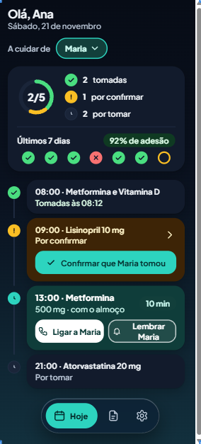
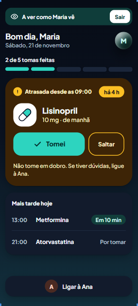

# Amparo

App de lembretes de medicação para cuidadores e para as pessoas de quem cuidam. Um cuidador acompanha várias pessoas, vê as tomas, recebe alertas e marca o que foi tomado. A pessoa acompanhada usa um modo simples e liga o telemóvel por código, sem criar conta.

<table>
  <tr>
    <td align="center"> Hoje (cuidador)</td>
    <td align="center"> Hoje (pessoa acompanhada)</td>
    <td align="center"> Receitas</td>
    <td align="center"> Alarme</td>
  </tr>
</table>

Mockups do desenho, feito no Claude Design ([`docs/design.md`](docs/design.md)). A app Flutter está a ser implementada a partir deles.

## Limites do produto

- **A app não substitui o médico.** Regista e lembra o que o médico decidiu; nunca sugere, calcula nem interpreta nada clínico (doses, interações, valores de sinais).
- **Sem anúncios nem venda de dados.** Segurança e acessibilidade ficam sempre gratuitas.

## Decisões de engenharia

- **Autorização por perfil.** Cada acesso a uma pessoa passa por `profile_access`, com testes dedicados a IDOR.
- **Dados de saúde (RGPD).** Email cifrado em repouso (AES-256-GCM), auditoria de leituras, exportação e apagar conta, registos sem dados pessoais. DPIA e política de privacidade em rascunho.
- **Tomas geradas de forma assíncrona**, por intervalo ou por horas fixas e com fuso horário correto, e sincronizadas por delta, para funcionar com pouca rede.
- **Alarmes locais no telemóvel.** O Firebase serve só para push; a hora do alarme não depende do servidor.
- **Operação.** Podman + Caddy, papel de base de dados sem permissão sobre a auditoria, backups cifrados com teste de restauro automático.

## Tecnologia

| Camada | Linguagem | Framework e ferramentas |
|---|---|---|
| App | Dart | Flutter |
| API | TypeScript | Node.js, Express 5, Zod (validação) |
| Base de dados | SQL | PostgreSQL, migrações com `node-pg-migrate` |
| Segurança | | Argon2, JWT (`jose`), `helmet`, rate limiting |
| Testes e CI | TypeScript | Vitest + Supertest (cerca de 250 casos), GitHub Actions |
| Infraestrutura | | Podman, Caddy |
| Push | | Firebase Cloud Messaging |

## Estado

**Backend:** autenticação (email, Google e Apple, verificação e recuperação de palavra-passe), perfis e permissões, medicamentos e receitas com stock, tomas, ligação do telemóvel por código, alertas ao cuidador e push (FCM), auditoria e RGPD, deploy e CI.

**App:** ligada à API, com entrar e criar conta, adicionar pessoa e ligar telemóvel por código, receitas, ecrã *Hoje* do cuidador e da pessoa acompanhada, histórico de tomas com gráfico, e definições de alertas, som do alarme e tamanho do texto.

## Roadmap

- [ ] Alarmes locais no telemóvel, com "Adiar 10 minutos"
- [ ] Push no lado Flutter ([`push-flutter`](docs/push-flutter.md))
- [ ] Reposição de stock ([`reposicao-stock`](docs/reposicao-stock.md))
- [ ] Fila offline para marcar tomas sem rede ([`fila-offline`](docs/fila-offline.md))
- [ ] Vários cuidadores por pessoa ([`varios-cuidadores`](docs/varios-cuidadores.md))
- [ ] Consultas, análises e exames, com lembretes ([`consultas-e-analises`](docs/consultas-e-analises.md))

Mais ideias (fotos de receitas, widget e modo simples com voz, motivação, sintomas, diários, plano pago e publicação nas lojas) estão no [índice da documentação](docs/index.md).

## Estrutura

| Pasta | Conteúdo |
|---|---|
| `app/` | A app (Flutter) |
| `backend/` | A API (Node.js + Express + TypeScript + PostgreSQL) |
| `deploy/` | Deploy (Podman + Caddy) e backups |
| `docs/` | Plano técnico, desenho dos ecrãs, RGPD e planos das funcionalidades |
